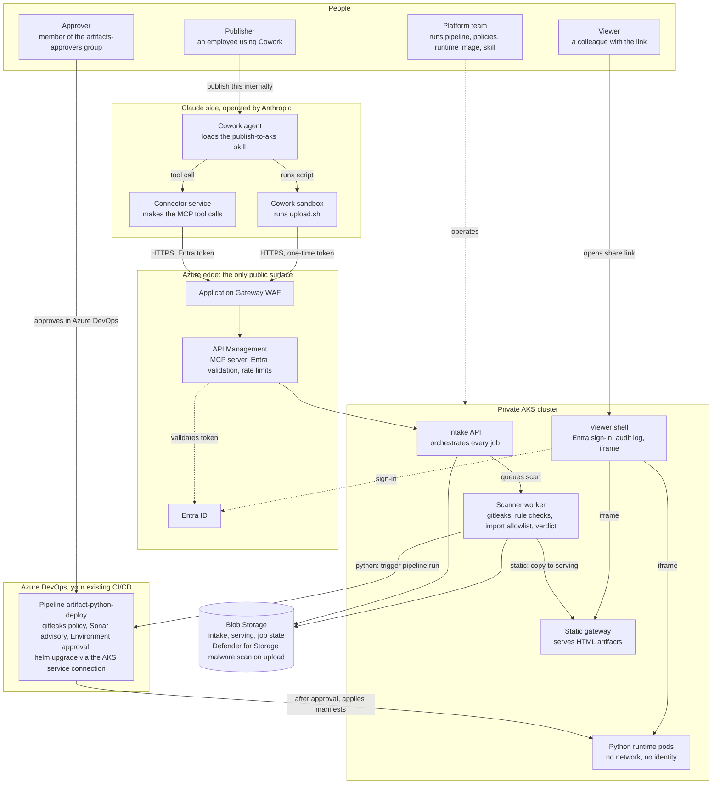
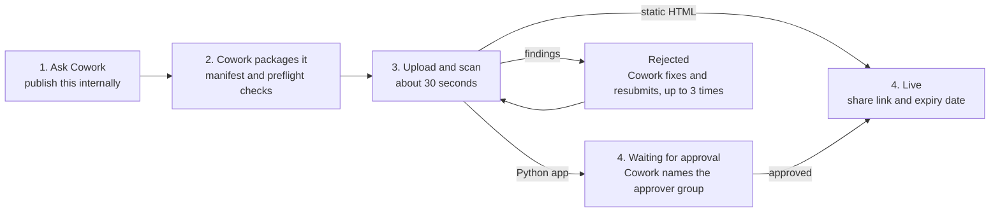
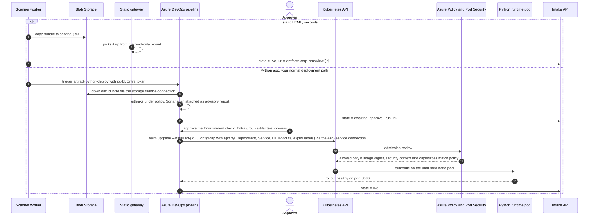
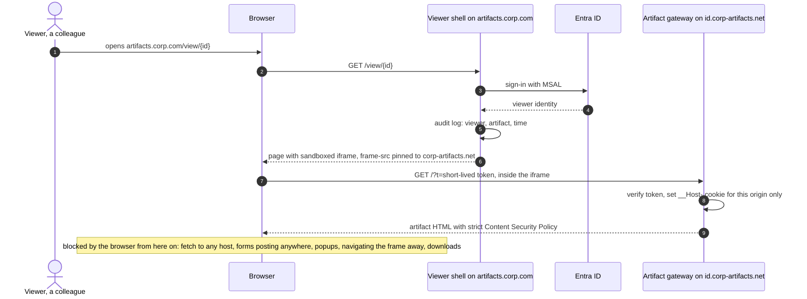
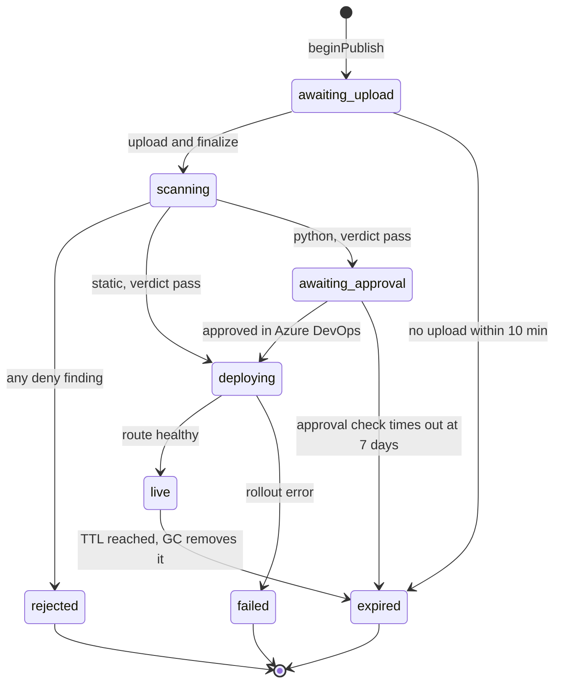
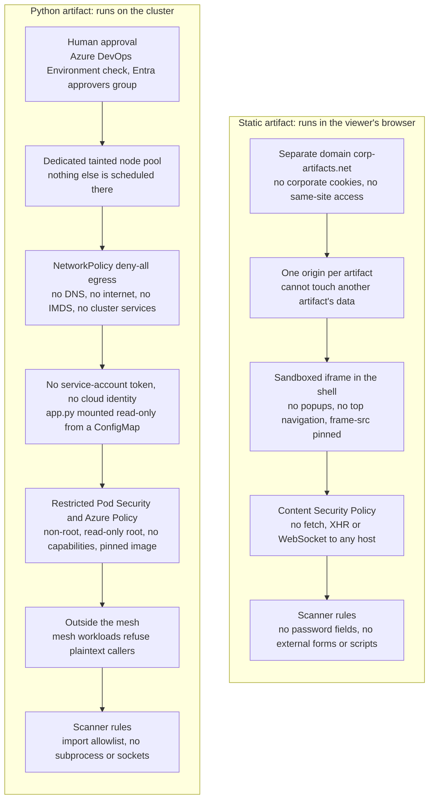

# Publish-to-AKS walkthrough: diagrams

Mermaid source for every figure. Paste a block into mermaid.live, Confluence, Azure DevOps wiki, or any Mermaid-capable renderer. Generated 2026-10-14 from the same source as the published walkthrough page.

## Figure 1. Who is involved

*Seventeen actors, four of them people, in five layers. Everything inside the private cluster is invisible to the publisher; they talk only to Cowork.*

Management version: an employee asks Cowork to publish. Cowork does the packaging and talks to one front door. Behind that door, the platform scans and decides. Static pages go straight to hosting. Python apps go through the same Azure DevOps pipeline and approval flow every other deployment in the organisation already uses. A colleague opens a link and signs in with their normal corporate account.



## Figure 2. What the publisher experiences

*Four steps for a static artifact, five for a Python app. The publisher never leaves Cowork.*

The employee's whole experience is a conversation. Cowork packages the work, uploads it, waits for the verdict, and either hands back a share link with an expiry date, names the people who need to approve, or fixes what the scanner flagged and tries again. Nobody opens a portal, a ticket, or a terminal.



## Figure 3. Behind the scenes: publish and scan

*Two separate channels leave Claude's side: tool calls carry the user's Entra identity, the upload carries a one-time token. Neither carries a password.*

The tool calls originate from Anthropic's connector service with the employee's Entra token, which APIM validates on every call. The upload comes from the Cowork sandbox, which has no identity of its own, so it presents a one-time token minted during the authenticated call. The artifact bytes never pass through the AI model. Malware scanning is done by Microsoft Defender for Storage the moment the upload lands in Blob; the rest of the checks run as a short-lived Kubernetes job per submission.

```mermaid
sequenceDiagram
  autonumber
  actor Pub as Publisher
  participant CW as Cowork agent
  participant SB as Cowork sandbox
  participant AN as Anthropic connector service
  participant GW as App Gateway and APIM
  participant ID as Entra ID
  participant IN as Intake API
  participant SC as Scanner worker
  participant BL as Blob Storage

  Pub->>CW: publish this dashboard internally
  CW->>CW: load publish-to-aks skill, write manifest.json, run preflight.sh
  CW->>AN: tool beginPublish(manifest)
  AN->>GW: POST /v1/publish with Entra bearer token
  GW->>ID: validate token, audience, scope
  ID-->>GW: valid, user oid
  GW->>IN: forward the bearer unchanged
  IN->>IN: verify the token itself (signature, issuer, audience, expiry); identity from claims
  IN-->>CW: jobId, uploadUrl, one-time uploadToken
  Note over AN,GW: replies travel back through APIM and the connector service
  CW->>SB: run upload.sh dist/
  SB->>GW: PUT /v1/publish/{jobId}/upload, bearer uploadToken, zip body
  GW->>IN: stream body, 32 MiB cap
  IN->>BL: write intake/{jobId}.zip
  BL->>BL: Defender for Storage scans the upload on commit
  SB->>GW: POST /v1/publish/{jobId}/finalize with sha256
  GW->>IN: forward
  IN->>SC: queue message on Service Bus
  SC->>BL: read bundle
  SC->>SC: intake checks, gitleaks, HTML and JS rules, Python import allowlist
  SC->>BL: read Defender scan result tag, wait up to 60 s
  SC->>SC: policy.ts verdict
  SC->>BL: write findings and state
  loop every 10 s, up to 10 min
    CW->>AN: tool getPublishStatus(jobId)
    AN->>GW: GET /v1/publish/{jobId}
    GW->>IN: forward
    IN-->>CW: state, and findings or url
  end
  CW-->>Pub: share link and expiry, or findings to fix
```

## Figure 4. Behind the scenes: going live

*Static artifacts go live in seconds by copying files. Python artifacts ride your existing Azure DevOps pipeline: scan, human approval, then cluster admission policy, using the AKS service connection you already have.*

The split is the heart of the design. A static artifact is data served from storage; nothing of it ever executes on the cluster, and nothing calls the Kubernetes API. A Python artifact executes on the cluster, so it goes through Azure DevOps like every other deployment: the pipeline fetches the bundle, runs gitleaks under your policy and Sonar as an advisory report, waits for a member of the approvers group to approve the Environment check, then applies the manifests with the AKS service connection. The cluster's own admission policy still refuses the pod unless its image, security settings and capabilities match what the platform team pinned.



## Figure 5. What the viewer experiences

*A colleague signs in once on the corporate domain. The artifact itself renders from a separate domain inside a sandboxed frame that the browser will not let navigate away.*

The share link always points at the viewer shell on the corporate domain. The shell does the Entra sign-in, writes an audit entry, and embeds the artifact from the separate artifact domain. From that point the browser enforces the rules: no outbound requests, no forms posting anywhere, no popups, no leaving the frame, no downloads. A persistent banner above the frame reminds viewers never to type credentials into an artifact.



## Figure 6. The life of one publish job

*Every job is in exactly one of nine states. The status tool reports the state and, when relevant, the findings or the approver group.*

This is the view operations will live in. Three exits are terminal: rejected, failed, expired. For Python artifacts, awaiting_approval and deploying are reported by the Azure DevOps pipeline. Nothing lives forever; the TTL in the manifest (default 14 days, maximum 90) is enforced by a nightly garbage-collection pipeline.



## Figure 7. If a bad artifact gets through the scanner

*The scanner is a gate, not the wall. Each column lists what an attacker must defeat, outermost first, before anything of value is reachable.*

This is the answer to the question management will ask: what happens when the scan misses something? For static artifacts, the browser's own security model does the containing. For Python artifacts, the cluster does: no network, no identity, no storage, a node pool shared with nothing else, and a human who said yes.



## Who does what

| Role | Who | Does | How often |
|---|---|---|---|
| Publisher | Any employee with Cowork and the connector | Asks Cowork to publish. Fixes findings when asked. Receives the link and expiry. | Whenever they have something to share |
| Approver | Members of the Entra group artifacts-approvers | Opens the Azure DevOps run, reads the scan summary and Sonar report, approves or rejects the Environment check. | Per Python artifact, within 7 days |
| Viewer | Anyone in the tenant who gets the link | Opens the shell link, signs in, views the artifact. | Any time until the TTL |
| Platform team | Owners of the pipeline repo | Maintains the skill, the connector, the scanner image, the curated Python runtime, Azure Policy, the two Azure DevOps pipelines and the Environment check. Reviews pull requests to policy files. | Runtime image on request; policy by PR |
| Claude org Owner | Claude Team or Enterprise owner | Adds the custom connector once. Publishes the skill to the skills repo. | Once, then on changes |
| Azure identity admin | Entra administrator | Owns the two app registrations and the approvers group membership. | Setup, then membership changes |
